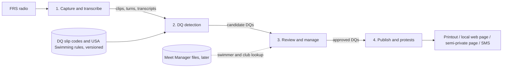
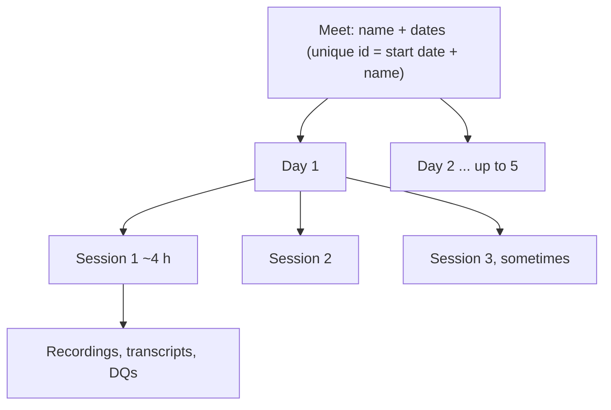
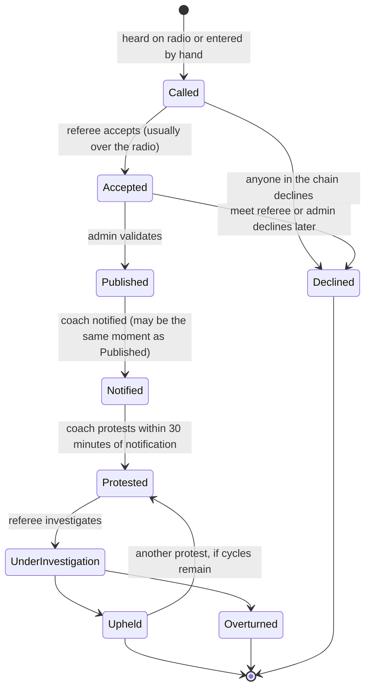

# dq_transcribe product plan

What the app is for, how it is broken into parts, and the order we build them in.
Written 2026-10-10 from the owner's description. Facts the owner stated are written
plainly. Anything marked **Proposed** is a suggestion still to be confirmed, and
**Open questions** collects what still needs an answer.

---

## 1. Purpose

At swim meets, officials call disqualifications ("DQs", said "dee cues") to the
referee over FRS radio. This app listens to that radio traffic and turns it into
DQ records. Officials review the records, publish them, and track them through
any protests.

- It runs local-first on a tablet (Lenovo Idea Tab, Android 16, Termux + Chrome).
  The core stays platform-neutral so it can move to Windows later.
- Audio and transcripts stay on the device. Speech-to-text is whisper.cpp, run locally.
- **Chances to capture real audio are rare.** The next one is **Friday 2026-10-16**,
  for 2 to 3 hours. Everything after component 1 is built and tuned on that recording.

## 2. Components

| # | Component | What it does | Status |
|---|-----------|--------------|--------|
| 1 | Audio capture and transcription | Listens to the radio, cuts clips, splits turns, transcribes, groups call/response exchanges | **Built and verified on the tablet with sample audio. Real radio audio not yet tested.** |
| 2 | DQ detection | Finds DQ calls in transcripts and fills in a DQ record (event, heat, lane, code, description, people) | Not started. Needs the reference data in section 6 |
| 3 | DQ management | Touch-screen review: view, edit, approve or decline, link to the source audio | Not started |
| 4 | Publication and protests | Publishes approved DQs (print, local web page, semi-private web page, SMS), notifies coaches, runs protest cycles | Not started |

## 3. Component 1: audio capture and transcription (current)

Already in place (details in `README.md` and `ai_docs/memory.md`):

- **Capture:** a browser page with Start/Stop and a blinking REC light. It cuts a
  clip when the radio is active and saves it in one folder per day.
- **Turns:** each clip is split into turns at pauses, and each turn is transcribed
  with whisper.cpp.
- **Grouping:** clips less than 5 s apart are grouped as one call/response exchange.
- **Editing:** transcripts can be edited; the original text is kept.
- **Raw data:** loudness, pauses and engine output are stored for later tuning.

**Remaining before Friday:** a dry run with the real radio, setting the levels,
and confirming that a 2–3 hour session holds up.

**Ground truth for Friday:** the owner will have the event/heat/lane of every DQ
from that session, and will get timing where possible. Matching the audio to
these real DQs is what lets us build and measure component 2.

## 4. Meets, days and sessions, and the DQ record

### 4.0 Meet structure (stated)

- **Meet:** one to many days (usually 1 to 4, sometimes 5). A meet has a **name**.
  Its unique id is its **date and name**, which is also how meets are sorted.
- **Day:** a date within the meet. A day has one or more sessions (sometimes 2,
  even 3).
- **Session:** usually about 4 hours, always under 8.

**Proposed:**
- **Meet records:** meets are stored as records (name, first and last date, Meet
  Manager file versions). Days and sessions belong to a meet.
- **Choosing the session:** the main window shows the active meet and session.
  Starting to capture asks which session it is for, defaulting to the current or
  next one, so a session can be chosen in one tap.
- **What belongs to a session:** every clip, transcript and DQ belongs to a
  session, and through it to a day and a meet.
- **Folders:** recordings move from one folder per day to
  `recordings/<meet start date>_<meet-name>/<YYYY-MM-DD>/session-<n>/`. Today's
  per-day folders already fit inside that layout.
- **DQ keys (stated):** event numbers are unique across the whole meet, so a DQ is
  found by **meet + event + heat + lane**. In the rare case of a conflict, events
  are told apart by adding a letter (for example "Event 2b"). **Proposed:** store
  the event as text ("2", "2b") and sort it as number then letter, so 2 < 2b < 10.

### 4.1 Fields

**Stated: a DQ cannot be published until all of these are complete:** Event,
Heat, Lane, Swimmer name, Swimmer club, DQ Official, Referee and short DQ
description. The DQ code is optional but wanted when available.

**Stated: the default sort is Event, then Heat, then Lane.** That is how DQs are
always looked up.

| Field | Required to publish | Notes |
|-------|----------|-------|
| Event | **yes** | First sort key |
| Heat | **yes** | Second sort key |
| Lane | **yes** | Third sort key |
| Relay leg | relays only | Which leg the infraction was called on: 1st, 2nd, 3rd or 4th (stated) |
| Swimmer name | **yes** | Auto-filled from the meet's Hy-Tek Meet Manager file using event/heat/lane (future). The admin types it when the lookup has nothing |
| Swimmer club | **yes** | Same as swimmer name |

**Relays (stated):** for a relay DQ, record the **leg** (1st to 4th swimmer) and,
instead of a swimmer name, the **relay name** written as club + "-" + relay letter
(for example "PASA-A", "PASA-B"). **Proposed:** a DQ has an "is relay" flag, set
from the Meet Manager event when known. For relays, the swimmer-name field
becomes "relay name" and the leg is required to publish.
| DQ code | no, but wanted | From the DQ slip. Some DQs have no code, and codes change between seasons |
| Description | **yes** | Short description. More universal than the code |
| Official | **yes** | Name of the person who made the call |
| Chief Judge | no | |
| Referee | **yes** | Name of the person who accepts the call (usually the deck referee, over the radio) |
| State | yes | See 4.2 |
| State history | yes | Every state change with its time (and, **proposed**, who made it) |
| Declined by / reason | when declined | Role and name of whoever declined it, and why (**proposed**) |
| Notified at | when notified | Starts the protest window (see 4.2) |
| Protest cycle count | yes | Number of protests so far |

**Proposed additional fields:**
- **Meet:** meet and session.
- **Source links:** links to the source clip(s) and utterance(s), so a reviewer can replay the call.
- **Detection notes:** how the record was detected (automatic or manual), with a match score.
- **Versions:** the DQ code table version and rules version used.
- **Notes:** a free-text field.

### 4.2 States and lifecycle

States the owner described: **Called → Accepted → (admin validates) → Published
→ Notified → Protested → Under Investigation → Upheld or Overturned.**
An Upheld DQ can be protested again, up to 2 (maybe 3) cycles, never without limit.

**Who can decline (stated):**
- Technically only the referee declines a DQ.
- In practice anyone in the chain can decline one that is unclear, confusing or
  poorly written: Chief Judge, Deck Referee, Meet Referee or Admin Official.
- Most calls are accepted over the radio at the time of the call. The meet referee
  may decline one later, and sometimes the admin is the one who checks the box.
- **The benefit of the doubt always goes to the swimmer.**

**Notification (stated):**
- The protest window starts at **Notification**, not at Published.
- In the paper process, handing the coach a copy of the DQ slip is the notification.
- Depending on how publication works, publishing may also count as notification.
- Coaches typically have **30 minutes** to protest.

**Rules:**
- Record the time of every state change. The **Notified** time matters most,
  because it starts the coach's protest window.
- A protest is only allowed while the protest window is open and the
  protest-cycle limit (2 or 3) has not been reached.
- **Proposed:** the protest window length (default 30 minutes), the cycle limit,
  and whether publishing counts as notifying are settings, not hard-coded values.
- **Proposed:** the UI shows a countdown of the time left in the protest window.
- **Proposed:** state changes are append-only history rows, not overwritten
  columns, so the full audit trail survives. Each row records the role and name
  of the person who made the change.
- **Proposed:** when the app is unsure (an ambiguous detection), it says so and
  leaves the decision to a person. It never fills in a guess as fact, because
  the benefit of the doubt goes to the swimmer.

## 5. Component 2: DQ detection (no online AI)

**What "without AI" means (stated):**
- **No online or cloud AI.** The network at swim meets is always rough.
- **A local model is allowed**, including a local LLM, if a free one can be
  installed on the tablet **as part of this app**.
- The model must be deployable with the solution.
- It should be possible to plug in new models as they evolve.

**Proposed: models behind interfaces.**
- Detection sits behind a small `DqMatcher` interface, the same way the speech
  engine already sits behind the `Transcriber` interface.
- Possible backends: (a) a rule-based matcher, which is the baseline and always
  available, and (b) an optional local LLM backend. For example, llama.cpp with a
  small model; it can be built on the tablet the same way whisper.cpp was.
- Both are scored against the same labeled data, so swapping in a new model is a
  measured decision.
- Model files live under `~/.dq_transcribe/models/`, and the model name and
  version are stored with every result.
- **llama.cpp is the chosen local LLM runtime (stated).** It must be part of the
  install on every target: Android (Termux), ChromeOS, Windows and Mac. See
  section 9a for how the install handles it.
- Whether a useful LLM runs fast enough on this tablet (8 GB RAM) is unknown, so it
  gets measured before we rely on it.

**Proposed approach (rule-based baseline):** a deterministic pipeline that produces
*candidates*, never final answers.

1. **Normalize the text:** lowercase, spell out or parse numbers ("event twelve" → 12), and fix
   common mishearings using a table we maintain.
2. **Pull out fields with patterns:** "event N", "heat N", "lane N", with variants learned from
   the Friday audio. Parse each part separately so one wrong part does not spoil the rest.
3. **Match the DQ description:** fuzzy-match the text against the description list from the
   current season's DQ slips (Python `difflib` or a token-overlap score), and offer the best few
   with scores.
4. **Find the people:** pick out the official and referee from a roster of names entered before
   the session, using fuzzy matching.
5. **Use the call/response structure:** a call ("referee, lane 4…") followed closely by an
   acknowledgment ("accepted", "copy") suggests Called → Accepted. Exact phrases come from the
   real audio.
6. **Mark unclear clips:** anything ambiguous becomes a "needs review" candidate rather than being
   dropped.

**Proposed: help the transcriber.** Passing whisper an initial prompt with meet
vocabulary (stroke names, DQ terms, officials' names) may improve accuracy. This
can be tested on the Friday audio.

**Proposed: measure it.** Label the Friday DQs using the owner's event/heat/lane
list. Then score the detector each time it or its model changes:
- how many real DQs it found,
- how many false ones it produced,
- how many fields it got right.

## 6. Reference data and versioning

- **DQ slips:** the owner will supply them. They include DQ codes and are updated almost
  every year, and codes can change.
- **USA Swimming technical rules:** they are also updated and need refreshing. The
  2026 rulebook is stored in `rulebook/`, with dated file names and a README that
  records the source, date and checksum.
- **Meet Manager (Hy-Tek) file:** loaded per meet, and reloadable mid-meet, to look up swimmer and club from event/heat/lane.

**Proposed:**
- Store DQ code tables as versioned data files, one per season, imported from the
  slips. Do not hard-code them.
- Each DQ records which version it was matched against.
- Re-importing a new season never rewrites old DQs.
- Keep a short summary of the relevant rules in the repo with the rules version
  and date, plus a reminder to check it each season.

## 7. Component 3: DQ management (touch-screen)

The owner wants a touch-friendly way to view, manage, edit, approve and decline DQs.

**Stated:**
- Transcribed calls will often be missing key information. The **Admin** (our main
  user) fills in the gaps, and must be able to do it **quickly**.
- The priority is to get **Event / Heat / Lane** complete promptly and to make sure
  the **short description** is captured.
- **Each call has a link icon** that opens a **popup with the transcript**. The
  popup has an **icon to play back the audio**.

**Proposed:**
- **Queue:** sorted by **event, heat, lane** by default (stated). Other sorts
  (newest first, incomplete first) are optional. The queue can be filtered by
  state. Each row shows event/heat/lane, swimmer and club, description, people,
  state, the age of the record, and the link icon.
- **Missing fields stand out:** any blank or uncertain field that publishing
  needs is highlighted. Publish stays disabled until every required field in 4.1
  is filled, and it lists what is still missing.
- **Fast entry, no keyboard:**
  - Tapping a missing field opens a large number pad or stepper (event, heat, lane).
  - Swimmer name and club are auto-filled from the loaded Meet Manager file using
    event/heat/lane, and can still be edited.
  - Description and code use a searchable picker from the current season's list,
    with the detector's best guesses shown first as one-tap choices.
  - The official and referee are picked from the roster.
- **Transcript popup** (from the link icon):
  - The transcript of every turn in the call/response group, with the time.
  - A play icon for the audio. Per-turn play is **proposed**.
  - Values the detector pulled out are highlighted in the text, so the admin can
    confirm them at a glance.
- **Actions:** Approve, Decline (with who and why), Merge duplicates, Split, and
  Add DQ by hand for calls the radio missed.
- **Edit history:** every edit is kept, and the original detected values remain
  visible.

## 8. Component 4: publication, notification and protests

The owner listed these possible outputs:

- **Printout:** **proposed** as a print-friendly page per DQ or per event, laid out
  like a DQ slip.
- **Local network page:** served on the meet's local network. The server
  currently listens only on the tablet itself, so this needs a deliberate,
  protected change.
- **Semi-private web page:** needs hosting off the tablet, plus some form of
  access control.
- **SMS pushes:** needs an SMS gateway or service, and coach phone numbers.

**Workflow:** publishing a DQ leads to coach notification (sometimes it *is* the
notification), and notification starts the 30-minute protest window. A
coach protest moves the DQ to Under Investigation. The referee then rules Upheld
or Overturned, and each ruling is time-stamped. Up to 2 or 3 protest cycles are
allowed.

**Proposed:** start with the printout and the local page, because they work
offline. Add SMS and the semi-private page later.

**Privacy (proposed):** many swimmers are minors. Published pages should show only
what is needed, and anything off the device needs access control.

## 9a. Install and packaging

**Stated:** llama.cpp must be included in the install on Android, ChromeOS,
Windows and Mac.

**Stated:** use each platform's built-in tools where possible.

**Proposed:**
- **One installer script per platform:**
  - **Android:** Termux (already working), `scripts/termux_setup.sh`.
  - **ChromeOS:** the built-in Linux development environment (a Debian container).
  - **Mac (stated):** the built-in Terminal. **Proposed:** a shell script using
    Apple's Command Line Tools.
  - **Windows (stated):** **WSL** (Windows Subsystem for Linux) only. No PowerShell
    scripts. **Proposed:** the Linux install script runs unchanged inside WSL (Ubuntu
    or Debian), and the browser on Windows opens the app at `localhost`.
- **What each installer does:**
  - installs Python;
  - builds or downloads **whisper.cpp** and **llama.cpp** (pinned versions), using
    prebuilt release binaries where they exist and building from source on Termux
    (as already done there for whisper.cpp);
  - downloads the chosen model files into `~/.dq_transcribe/models/`, checking
    each one's checksum.
- **Model list:** a small `models.json` (or constants) records each model's name,
  URL, size and checksum, so adding a new model is a data change.
- **Health check:** the app shows which engines and models are installed and
  working, so a broken install is obvious before a meet.
- **Offline:** the install needs the internet once. After that, everything runs
  offline at the meet.

## 9. Roadmap

| Phase | Goal | Depends on |
|-------|------|------------|
| 0 | Dry run with the radio, then capture 2–3 hours on Friday 2026-10-16 with ground-truth DQ slips | Owner at the meet |
| 1 | Review the Friday audio: tune capture and turn thresholds, measure whisper speed, hand-label the DQ calls | Phase 0 audio |
| 2 | Import reference data: DQ slip code table (versioned), rules summary, officials roster | Owner supplies slips and rules |
| 3 | Rule-based DQ detector, scored against the labeled Friday data | Phases 1 and 2 |
| 4 | DQ record, state machine and touch review UI | Phase 2; can start in parallel with phase 3 |
| 5 | Publication (print and local page first), protest workflow and timers | Phase 4 |
| 6 | Meet Manager file loading and auto-fill, SMS, semi-private page, WSL/Mac/ChromeOS installs | Sample files and decisions |

**Meet Manager file (stated):** swimmer name and club will come from the meet's
Hy-Tek Meet Manager file, auto-filled from event/heat/lane. The owner will get the
file for Friday's meet. These files can be **updated mid-meet**, so the main app
window needs a way to **browse for and load a new file** at any time.

**Proposed for the Meet Manager file:**
- **Loading (stated: file picker or web address):** a "Load meet file" button on
  the main window offers two ways in:
  1. **Pick a file:** the tablet's file picker, which covers local storage,
     Downloads and, **proposed**, a **USB thumb drive**. Android tablets can usually
     read a USB-C thumb drive, or a USB-A drive through an adapter, and Chrome's
     file picker can then choose files from it. Not yet tested on this tablet; worth
     trying before Friday.
  2. **Enter a web address:** the app downloads the file from a URL (for example a
     shared-drive link or a page on the meet's local network). This needs some
     network access at that moment. Meet networks are rough, so the file picker
     stays the fallback.
- **After loading:** the app imports the file and shows when it was loaded, where
  it came from, and what it contains (meet name, events, number of entries).
- **Context (stated):** Meet Manager runs on Windows, and the file is usually moved
  by USB thumb drive.
- **Versions:** each loaded file is kept as a dated version, and the newest one is
  active. Nothing loaded earlier is overwritten.
- **Reloading never overwrites:** after a new file is loaded, DQs whose looked-up
  name or club would change are flagged for the admin to confirm. A name the admin
  typed or confirmed is never silently replaced.
- **First step:** use Friday's file to work out the format. Which file type it is
  (a backup `.zip` holding the database, or an exported entries/results file) is
  still to be confirmed.

## 10. Needed from the owner

- [ ] Current DQ slips (photo or PDF), including codes and descriptions
- [ ] USA Swimming technical rules (current edition), or the sections that matter here
- [ ] Friday ground truth: event/heat/lane of every DQ (promised), with timing where possible
- [ ] Typical radio wording: how a call and an acceptance usually sound
- [ ] Officials and referee names for a meet (roster format)
- [x] Protest window: typically 30 minutes from notification (answered 2026-10-10)
- [ ] Protest-cycle limit (2 or 3?), or where the rule says
- [ ] Hy-Tek Meet Manager file for Friday's meet (owner is getting it)

## 11. Open questions

1. **Declined records:** is a declined DQ kept, hidden by default, or deleted?
   (**Proposed:** kept, with who declined it and why, for the audit trail.)
2. **Validation order:** in practice, can an admin validate or publish a DQ the referee has not
   accepted?
3. **Who is the admin:** one person per meet? Do we need logins, or is a single trusted tablet
   enough for now?
4. **Recording notification and protests:** who marks a coach as notified, and who records that a
   protest was filed (admin, referee, coach)?
5. **Overturned:** is it final, or can it be protested again (for example by another team)?
6. **Corrections after publication:** what happens if a published DQ has a typo (wrong lane)? Is it
   corrected in place with an audit entry, or republished?
7. **Local LLM size:** how much tablet time and storage can a local model use? This decides
   whether an LLM backend is practical or the rule-based matcher carries the load.

### Answered

- **"Without AI"** (2026-10-10): no online AI, because meet networks are rough. Local models,
  including a local LLM, are fine if they ship with the app, and models should be pluggable.
- **Who declines** (2026-10-10): technically the referee. In practice anyone in the chain (Chief
  Judge, Deck Referee, Meet Referee, Admin Official) can decline an unclear call. The benefit of
  the doubt always goes to the swimmer.
- **Protest window start** (2026-10-10): at Notification, which may be the same moment as
  publication. In the paper process, handing the coach a copy of the slip is notification. The
  window is typically 30 minutes.
- **Required to publish** (2026-10-10): event, heat, lane, swimmer name, swimmer club, DQ official,
  referee and short description. The DQ code is optional but wanted. Default sort is
  event/heat/lane.
- **Install targets** (2026-10-10): use built-in tools. ChromeOS uses its Linux environment, Mac
  uses Terminal, and Windows uses **WSL only (no PowerShell)**.
- **Swimmer name and club** (2026-10-10): from the Hy-Tek Meet Manager file, auto-filled by
  event/heat/lane. The file can change mid-meet, so a new one can be loaded from the main window.
- **Meet structure** (2026-10-10): meet → days (1–5) → sessions (1–3 a day, about 4 h, under 8).
  A meet is identified and sorted by date + name.
- **Getting the Meet Manager file** (2026-10-10): load it from the file picker or a web address.
  Usually it comes by USB thumb drive from the Windows Meet Manager machine.
- **Event numbers** (2026-10-10): unique across the meet. A rare conflict is broken with a letter
  (Event 2b).
- **Relays** (2026-10-10): record the leg (1st to 4th) and the relay name as club-letter
  (PASA-A) in place of a swimmer name.
