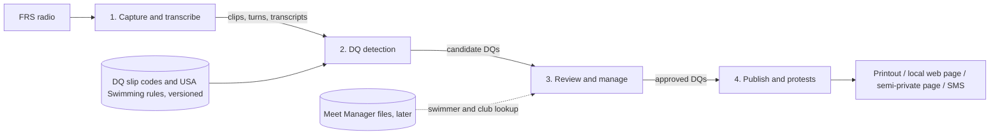

# dq_transcribe product plan

What the app is for, how it is broken into parts, and the order we build them in.
Written 2026-10-10 from the owner's description. Facts the owner stated are written
plainly. Anything marked **Proposed** is a suggestion still to be confirmed, and
**Open questions** collects what still needs an answer.

---

## 1. Purpose

At swim meets, officials call disqualifications ("DQs", said "dee cues") to the
referee over FRS radio. This app listens to that radio traffic and turns it into
DQ records. Officials review the records, publish them, and track them through
any protests.

- It runs local-first on a tablet (Lenovo Idea Tab, Android 16, Termux + Chrome).
  The core stays platform-neutral so it can move to Windows later.
- Audio and transcripts stay on the device. Speech-to-text is whisper.cpp, run locally.
- **Chances to capture real audio are rare.** The next one is **Friday 2026-10-16**,
  for 2 to 3 hours. Everything after component 1 is built and tuned on that recording.

## 2. Components

| # | Component | What it does | Status |
|---|-----------|--------------|--------|
| 1 | Audio capture and transcription | Listens to the radio, cuts clips, splits turns, transcribes, groups call/response exchanges | **Built and verified on the tablet with sample audio. Real radio audio not yet tested.** |
| 2 | DQ detection | Finds DQ calls in transcripts and fills in a DQ record (event, heat, lane, code, description, people) | Not started. Needs the reference data in section 6 |
| 3 | DQ management | Touch-screen review: view, edit, approve or decline, link to the source audio | Not started |
| 4 | Publication and protests | Publishes approved DQs (print, local web page, semi-private web page, SMS), notifies coaches, runs protest cycles | Not started |

## 3. Component 1: audio capture and transcription (current)

Already in place (details in `README.md` and `ai_docs/memory.md`):

- **Capture:** a browser page with Start/Stop and a blinking REC light. It cuts a
  clip when the radio is active and saves it in one folder per day.
- **Turns:** each clip is split into turns at pauses, and each turn is transcribed
  with whisper.cpp.
- **Grouping:** clips less than 5 s apart are grouped as one call/response exchange.
- **Editing:** transcripts can be edited; the original text is kept.
- **Raw data:** loudness, pauses and engine output are stored for later tuning.

**Remaining before Friday:** a dry run with the real radio, setting the levels,
and confirming that a 2–3 hour session holds up.

**Proposed for Friday:** collect *ground truth* alongside the recording. The most
valuable item is the day's paper DQ slips, or photos of them, plus any notes on
when calls happened. Matching the audio to the real DQs is what will let us build
and measure component 2.

## 4. The DQ record

### 4.1 Fields

| Field | Required | Notes |
|-------|----------|-------|
| Event | yes | First key |
| Heat | yes | Second key |
| Lane | yes | Third key |
| Swimmer name | later | Looked up from Meet Manager files using event/heat/lane |
| Club | later | Same lookup |
| DQ code | no | From the DQ slip. Some DQs have no code, and codes change between seasons |
| Description | yes | Short description. More universal than the code |
| Official | yes | Name of the person who made the call |
| Chief Judge | no | |
| Referee | yes | Name of the person who accepts the call |
| State | yes | See 4.2 |
| State history | yes | Every state change with its time (and, **proposed**, who made it) |
| Protest cycle count | yes | Number of protests so far |

**Proposed additional fields:**
- **Meet:** meet and session.
- **Source links:** links to the source clip(s) and utterance(s), so a reviewer can replay the call.
- **Detection notes:** how the record was detected (automatic or manual), with a match score.
- **Versions:** the DQ code table version and rules version used.
- **Notes:** a free-text field.

### 4.2 States and lifecycle

States the owner described: **Called → Accepted → (admin validates) → Published
(coaches notified) → Protested → Under Investigation → Upheld or Overturned.**
An Upheld DQ can be protested again, up to 2 (maybe 3) cycles, never without limit.

```mermaid
stateDiagram-v2
    [*] --> Called: heard on radio or entered by hand
    Called --> Accepted: referee accepts
    Called --> Declined: not a DQ / false detection (proposed)
    Accepted --> Published: admin validates; coaches notified
    Accepted --> Declined: admin declines (proposed)
    Published --> Protested: coach protests within the protest window
    Protested --> UnderInvestigation: referee investigates
    UnderInvestigation --> Upheld
    UnderInvestigation --> Overturned
    Upheld --> Protested: another protest, if cycles remain
    Upheld --> [*]
    Overturned --> [*]
    Declined --> [*]
```

**Rules:**
- Record the time of every state change. The **Published** time matters most,
  because it starts the coach's protest window.
- A protest is only allowed while the protest window is open and the
  protest-cycle limit (2 or 3) has not been reached.
- **Proposed:** the protest window length and the cycle limit are settings, not
  hard-coded values. They get confirmed against the USA Swimming rules (section 6).
- **Proposed:** state changes are append-only history rows, not overwritten
  columns, so the full audit trail survives.

## 5. Component 2: DQ detection (without AI)

The owner wants calls matched to DQs **without AI**.

**Proposed reading:** no LLM or cloud service. whisper.cpp stays (it is already
the transcriber), and matching is rule-based and explainable. See Open questions.

**Proposed approach:** a deterministic pipeline that produces *candidates*, never
final answers.

1. **Normalize the text:** lowercase, spell out or parse numbers ("event twelve" → 12), and fix
   common mishearings using a table we maintain.
2. **Pull out fields with patterns:** "event N", "heat N", "lane N", with variants learned from
   the Friday audio. Parse each part separately so one wrong part does not spoil the rest.
3. **Match the DQ description:** fuzzy-match the text against the description list from the
   current season's DQ slips (Python `difflib` or a token-overlap score), and offer the best few
   with scores.
4. **Find the people:** pick out the official and referee from a roster of names entered before
   the session, using fuzzy matching.
5. **Use the call/response structure:** a call ("referee, lane 4…") followed closely by an
   acknowledgment ("accepted", "copy") suggests Called → Accepted. Exact phrases come from the
   real audio.
6. **Mark unclear clips:** anything ambiguous becomes a "needs review" candidate rather than being
   dropped.

**Proposed: help the transcriber.** Passing whisper an initial prompt with meet
vocabulary (stroke names, DQ terms, officials' names) may improve accuracy. This
can be tested on the Friday audio.

**Proposed: measure it.** Hand-label the Friday DQs. Then score the detector
(how many real DQs it found, how many false ones, and how many fields were right)
each time it changes.

## 6. Reference data and versioning

- **DQ slips:** the owner will supply them. They include DQ codes and are updated almost
  every year, and codes can change.
- **USA Swimming technical rules:** for review. They are also updated and need refreshing.
- **Meet Manager files:** in the future, to look up swimmer and club from event/heat/lane.

**Proposed:**
- Store DQ code tables as versioned data files, one per season, imported from the
  slips. Do not hard-code them.
- Each DQ records which version it was matched against.
- Re-importing a new season never rewrites old DQs.
- Keep a short summary of the relevant rules in the repo with the rules version
  and date, plus a reminder to check it each season.

## 7. Component 3: DQ management (touch-screen)

The owner wants a touch-friendly way to view, manage, edit, approve and decline DQs.

**Proposed:**
- **Queue:** newest first, filterable by state. Each card shows event/heat/lane,
  description, people, state and the age of the record.
- **Big controls:** large tap targets with no typing needed for common edits.
  Event, heat and lane use steppers. Code and description use a searchable picker
  from the current table. Officials and referee are picked from the roster.
  (Sliders and steppers suit a tablet better than the keyboard.)
- **Source audio:** play the source clip and see its transcript on the same card.
- **Actions:** Approve, Decline, Merge duplicates, Split, and Add DQ by hand for
  calls the radio missed.
- **Edit history:** every edit is kept, and the original detected values remain
  visible.

## 8. Component 4: publication, notification and protests

The owner listed these possible outputs:

- **Printout:** **proposed** as a print-friendly page per DQ or per event, laid out
  like a DQ slip.
- **Local network page:** served on the meet's local network. The server
  currently listens only on the tablet itself, so this needs a deliberate,
  protected change.
- **Semi-private web page:** needs hosting off the tablet, plus some form of
  access control.
- **SMS pushes:** needs an SMS gateway or service, and coach phone numbers.

**Workflow:** a published DQ notifies coaches and starts the protest window. A
coach protest moves the DQ to Under Investigation. The referee then rules Upheld
or Overturned, and each ruling is time-stamped. Up to 2 or 3 protest cycles are
allowed.

**Proposed:** start with the printout and the local page, because they work
offline. Add SMS and the semi-private page later.

**Privacy (proposed):** many swimmers are minors. Published pages should show only
what is needed, and anything off the device needs access control.

## 9. Roadmap

| Phase | Goal | Depends on |
|-------|------|------------|
| 0 | Dry run with the radio, then capture 2–3 hours on Friday 2026-10-16 with ground-truth DQ slips | Owner at the meet |
| 1 | Review the Friday audio: tune capture and turn thresholds, measure whisper speed, hand-label the DQ calls | Phase 0 audio |
| 2 | Import reference data: DQ slip code table (versioned), rules summary, officials roster | Owner supplies slips and rules |
| 3 | Rule-based DQ detector, scored against the labeled Friday data | Phases 1 and 2 |
| 4 | DQ record, state machine and touch review UI | Phase 2; can start in parallel with phase 3 |
| 5 | Publication (print and local page first), protest workflow and timers | Phase 4 |
| 6 | Meet Manager lookup, SMS, semi-private page, Windows port | Sample files and decisions |

## 10. Needed from the owner

- [ ] Current DQ slips (photo or PDF), including codes and descriptions
- [ ] USA Swimming technical rules (current edition), or the sections that matter here
- [ ] Friday ground truth: the day's DQ slips or a list of DQs, ideally with rough times
- [ ] Typical radio wording: how a call and an acceptance usually sound
- [ ] Officials and referee names for a meet (roster format)
- [ ] Protest window length and protest-cycle limit, or where the rule says
- [ ] Later: sample Meet Manager files

## 11. Open questions

1. **"Without AI":** does this rule out only LLMs and cloud services, or also local machine-learning
   models other than whisper (for example a local classifier)?
2. **Declined:** who can decline a DQ? Is it the admin only, or also the referee (a call that is
   heard but not accepted)? Is a declined record kept or deleted? (**Proposed:** kept, hidden by
   default.)
3. **Validation:** does admin validation happen before or after the referee's acceptance in
   practice? Can an admin publish a DQ the referee has not accepted?
4. **Who is the admin:** one person per meet? Do we need logins, or is a single trusted tablet
   enough for now?
5. **Protest window:** does it start at Published, at coach notification, or at results posting?
   Who records that a protest was filed (admin, referee, coach)?
6. **Overturned:** is it final, or can it be protested again (for example by another team)?
7. **Meets and sessions:** does a meet run over several days and sessions, and should records be
   grouped by meet?
8. **Corrections after publication:** what happens if a published DQ has a typo (wrong lane)? Is it
   corrected in place with an audit entry, or republished?
